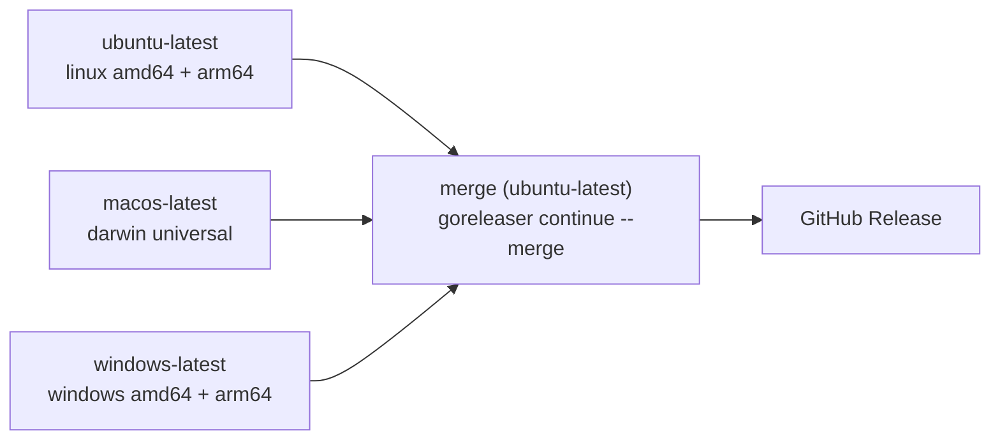

# GoReleaser Pro Rust Split & Merge Example

A tiny Rust CLI released with [GoReleaser Pro](https://goreleaser.com/pro/)
using its [split/merge](https://goreleaser.com/customization/partial/) mode.
The binary only prints its version and build target. The release setup is the
point.

## What split/merge is

Instead of one machine building every target, each runner runs
`goreleaser release --split` and builds only part of the matrix. The partial
`dist/` directories are uploaded as artifacts. One final job downloads them all
and runs `goreleaser continue --merge`, which writes the checksums and
publishes a single GitHub Release.

## Why one runner per OS

Cross-compiling to another OS needs a toolchain you have to install and
maintain: osxcross, mingw, `cargo-zigbuild` and friends. Cross-compiling to
another architecture on the same OS is easy: the runner already has the SDK or
a linker one `apt-get` away. So we split by OS and let each runner build both
of its architectures with plain `cargo build` (`command: build`):

| Runner           | Targets                                                  | What it needs                                |
| ---------------- | -------------------------------------------------------- | -------------------------------------------- |
| `ubuntu-latest`  | `x86_64-unknown-linux-gnu`, `aarch64-unknown-linux-gnu`  | `gcc-aarch64-linux-gnu` as the arm64 linker  |
| `macos-latest`   | `x86_64-apple-darwin`, `aarch64-apple-darwin`            | Xcode SDK, already installed                 |
| `windows-latest` | `x86_64-pc-windows-msvc`, `aarch64-pc-windows-msvc`      | MSVC x64 and ARM64 tools, already installed  |

Both macOS targets build on the same runner, so `universal_binaries`
(`replace: true`) can combine them into one universal binary during `--split`.

## How the jobs fit together



Each leg of the `split` job runs `cargo test`, then `goreleaser release
--split`, then uploads `dist/`. The `merge` job waits for all three.

There is a single [`.goreleaser.yaml`](.goreleaser.yaml). `partial.by: goos`
makes each runner write to its own `dist/<os>/` directory, so nothing collides
when the parts are merged.

The workflow is [`.github/workflows/release.yml`](.github/workflows/release.yml).
Tags matching `v*` publish a release. Pull requests and manual runs add
`--snapshot`, so nothing is published.

## Verification

The `verify` section of `.goreleaser.yaml` is a GoReleaser Pro feature. After
`continue --merge` publishes the release, it downloads the published assets and
runs `sha256sum -c checksums.txt` against them. It only runs on real releases.
Snapshots publish nothing, so there is nothing to verify.

## Use it in your repo

1. Copy `.goreleaser.yaml` and `.github/workflows/release.yml`. Change the
   project name, binary name and targets to match yours.
2. Add your GoReleaser Pro license key as the `GORELEASER_KEY` Actions secret.
3. Open a pull request, or run **Actions → release → Run workflow**, to test it
   with a snapshot.
4. Push a tag to publish:

   ```sh
   git tag v0.1.0 && git push origin v0.1.0
   ```

Pull requests from forks skip the release jobs because they do not get
`GORELEASER_KEY`.

## License

[MIT](LICENSE)
