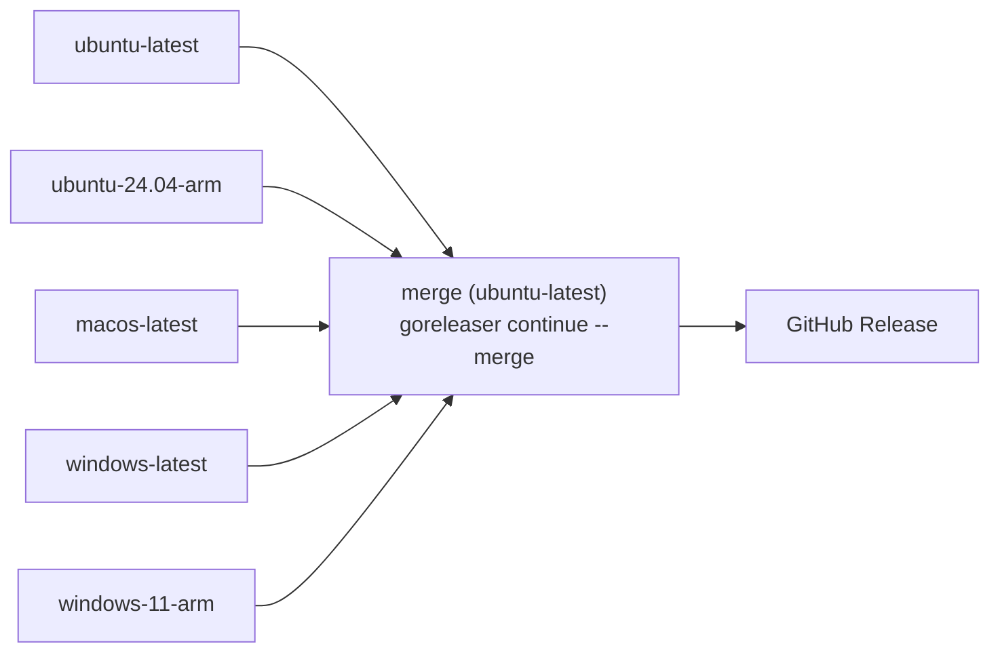

# GoReleaser Pro Rust Split & Merge Example

A tiny Rust CLI released with [GoReleaser Pro](https://goreleaser.com/pro/)
using its [split/merge](https://goreleaser.com/customization/partial/) mode.
The binary only prints its version and build target. The release setup is the
point.

## What split/merge is

Instead of one machine building every target, each runner runs
`goreleaser release --split` and builds only what it can build natively. The
partial `dist/` directories are uploaded as artifacts. One final job downloads
them all and runs `goreleaser continue --merge`, which writes the checksums and
publishes a single GitHub Release.

## Why native runners

- No cross-compilation toolchain. It is plain `cargo build` (`command: build`),
  not `cargo-zigbuild` or `cross`, so you do not need cross linkers or sysroots.
- `cargo test` runs on every platform before anything is packaged, so you test
  the binary you actually ship.
- Linux, macOS and Windows, on x64 and ARM64.

## How the jobs fit together



Each matrix leg of the `split` job runs `cargo test`, then
`goreleaser release --split`, then uploads `dist/`. The `merge` job waits for
all of them.

Linux and Windows legs use [`.goreleaser.yaml`](.goreleaser.yaml) with
`partial.by: target`, so each runner builds one target triple. macOS is the
exception: it uses [`.goreleaser.darwin.yaml`](.goreleaser.darwin.yaml) with
`partial.by: goos`. `universal_binaries` runs during `--split`, so both
`aarch64-apple-darwin` and `x86_64-apple-darwin` must be built on the same
runner to be combined into one universal binary.

The workflow is [`.github/workflows/release.yml`](.github/workflows/release.yml).
Tags matching `v*` publish a release. Pull requests and manual runs add
`--snapshot`, so nothing is published.

## Use it in your repo

1. Copy `.goreleaser.yaml`, `.goreleaser.darwin.yaml` and
   `.github/workflows/release.yml`. Change the project name, binary name and
   targets to match yours.
2. Add your GoReleaser Pro license key as the `GORELEASER_KEY` Actions secret.
3. Open a pull request, or run **Actions → release → Run workflow**, to test it
   with a snapshot.
4. Push a tag to publish:

   ```sh
   git tag v0.1.0 && git push origin v0.1.0
   ```

Pull requests from forks skip the release jobs because they do not get
`GORELEASER_KEY`.

## License

[MIT](LICENSE)
